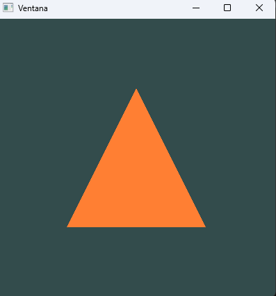
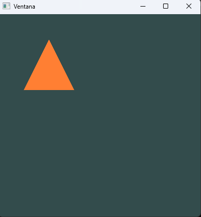
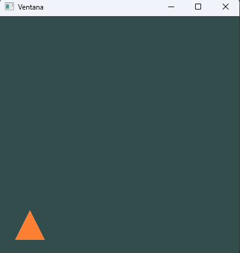
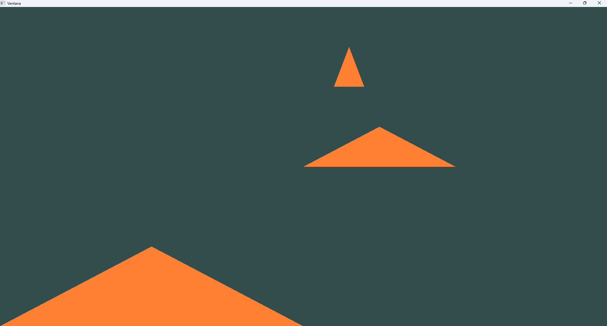
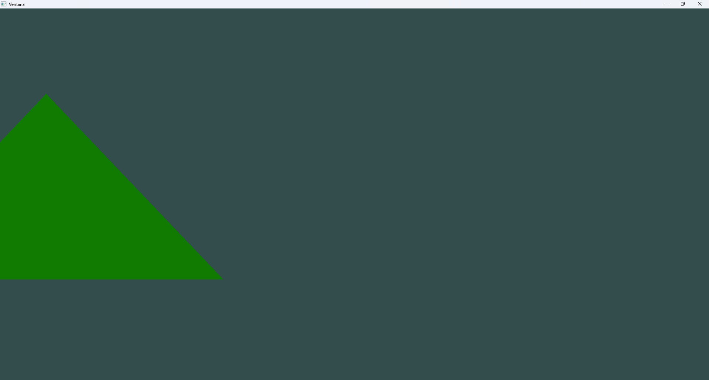
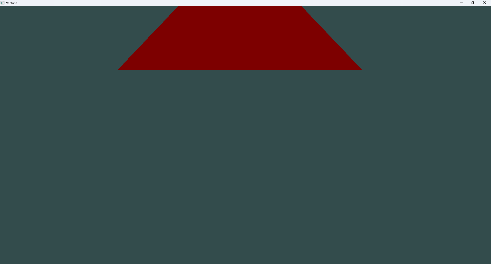
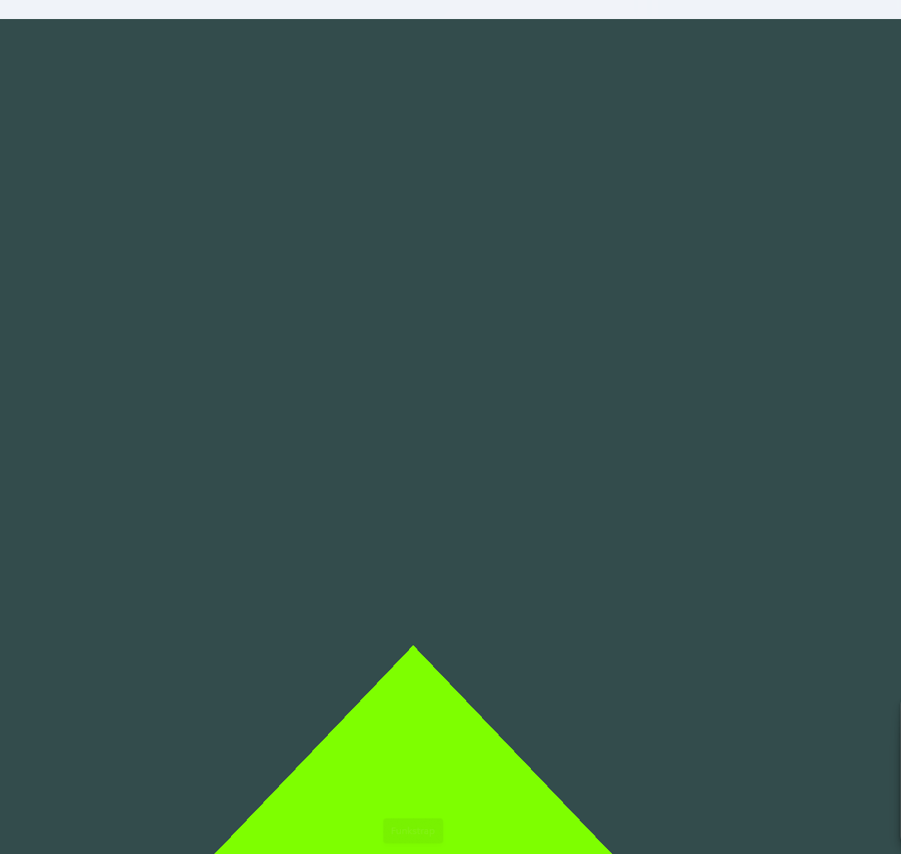
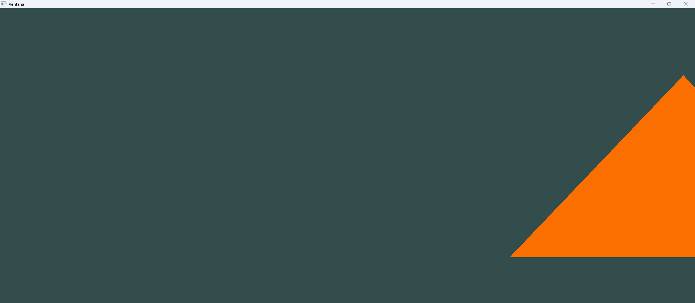
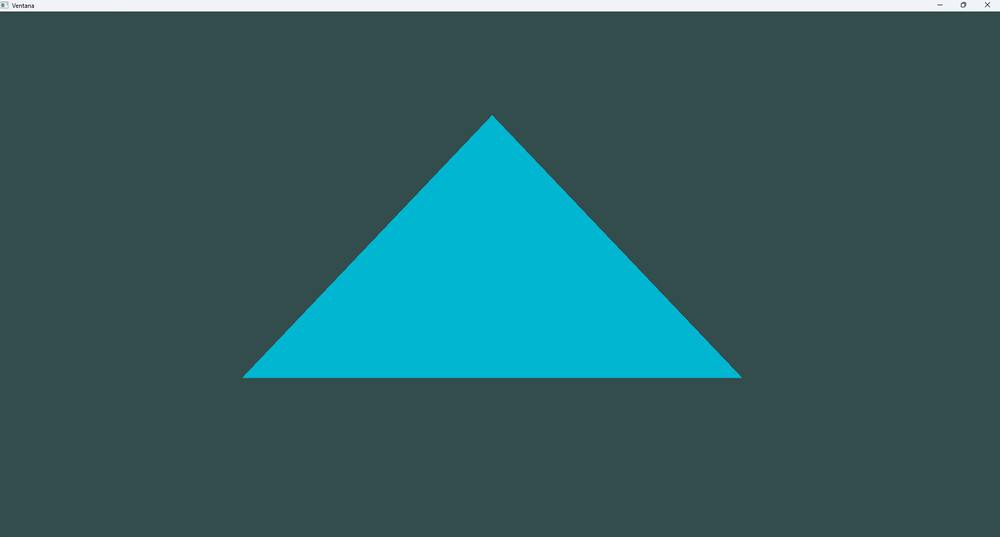

# Unidad-4-sistemas-computacionales (Bitacora)
# Actividad 1

## Orientación y primer vistazo al entorno gráfico


### 1. Compila y ejecuta el ejemplo

📤

### 🧐🧪✍️ Reporta en tu bitácora

#### 1. Incluye una captura de pantalla del ejemplo funcionando en tu máquina.

#### 2. Observa el proyecto, trata de entenderlo, pero ten presente que lo analizaremos más adelante.
#### 3. ¿Qué preguntas te surgen al ver el código? Anota al menos tres preguntas que te gustaría investigar más adelante (no te preocupes que la idea de esta unidad es que las resuelvas).

- Como se dibuja esto dentro de la GPU?
- Como se redirecciona de la CPU a la GPU?
- Como es que se calculan los pixeles y posiciones?

# Actividad 02

## ¿Cómo se crea un proyecto OpenGL en Windows?
### Resumen
```GLFW``` crea la ventana, ```opengl32.lib``` enciende ```OpenGL```,```GLAD``` trae las funciones modernas desde los drivers de la GPU y ```GLM``` ayuda con las matematicas.
### ¿Como se relacionan?
```GLFW``` prepara el lienzo, ```GLAD``` consigue las herramientas modernas desde los drivers, ```opengl32.lib``` se conecta con Windows y ```GLM```aporta en las matematicas.

# Actividad 3

### Experimento: viewport



- Con la mitad y origen en la mitad de la altura, el triángulo queda en el cuadrante superior izquierdo.
- Dividiendo entre 4, se hace más pequeño en la esquina inferior izquierda.
- Multiplicando por 2, se agranda y se recorta por los bordes.
- El viewport mapea las coordenadas NDC (-1 a 1) a esa región del framebuffer.

### Experimento: glDrawArrays


- `GL_LINES`: dibuja una línea entre los dos primeros vértices.
- `GL_POINTS`: tres puntos, uno por vértice.
- Con 2 vértices y `GL_TRIANGLES`: no dibuja nada.
- Con 4: lee un vértice inexistente (comportamiento indefinido).

### Preguntas
1. **Contexto OpenGL:** OpenGL guarda su estado y su conexion con la ventana.
2. **GLFW:** crea ventana y contexto y maneja el teclado y mouse; es multiplataforma.
3. **Por que necesita contexto:** como el artista necesita un estudio, OpenGL necesita saber donde se dibuja y que recursos.
4. **Framebuffer:** memoria con el color de cada pixel del cuadro (de hecho se parece a la imagen como matriz de pixeles que vimos en la unidad 1 y 2).
5. **Viewport y framebuffer:** el framebuffer es toda la memoria de imagen; el viewport es la parte donde se dibuja.
6. **Drivers y GPU:** los drivers traducen OpenGL a instrucciones de la GPU, que ejecuta los shaders y pinta el framebuffer.
7. **VSync:** sincroniza con el monitor; sin el, una imagen dinamica muestra tearing, y si es estatica casi no se nota.
8. **Legacy vs moderno:** el legacy usa pipeline fijo (`glBegin/glEnd`); el moderno usa shaders y buffers.
9. **Shader program:** une el vertex y el fragment shader compilados; es obligatorio en OpenGL moderno.
10. **setupTriangle:** crea el VBO (datos en la GPU) y el VAO (como leerlos).
11. **¿Repetir cada frame?** Con un objeto y un shader no; si al alternar entre varios.
12. **glfwSwapBuffers:** intercambia buffer trasero y delantero; sin el no se ve lo dibujado.

# Actividad 4
## Parte 1:
### Diferencia entre GPU y CPU
- La ```CPU``` tiene poco nucleos, bastante potentes y flexibles, realiza tareas complejas una tras otra (o pocas a la vez), como la logica del programa, el sistema operativo o la IA de algun juego.
- La ```GPU``` tiene miles de nucleos pequeños y simples. Hace la misma operacion sobre muchisimos datos al mismo tiempo.
- **¿Porque sirve para graficos?**
sirve para pintar una imagen, calcular el color de millones de pixeles, y cada uno se calcula de forma independiente con la misma formula.

-  **Analisis del video** 
la CPU es un cañon de paintball que dispara un tiro preciso a la vez. La GPU es un cañon gigante que dispara miles de bolas de pintura al mismo tiempo y pinta la imagen completa de golpe.

## Parte 2:
#### 1. ¿Cuáles son los tres pasos claves del pipeline de OpenGL? Explica en tus propias palabras cuál es el objetivo de cada paso.
- **Vertex Processing**: Los vertices pasan por el vertex shader y se transforman a su posicion final en la pantalla.

- **Raterizacion**: los triangulos se convierten en fragmentos.

- **Fragment Processing**: El fragment shader calcula el color de cada fragmento

#### 2. La gran novedad que introduce OpenGL moderno es el pipeline programable. ¿Qué significa esto? ¿Qué diferencia hay entre el pipeline fijo y el programable? ¿Qué ventajas le ves a esto? y si el pipeline es programable, ¿Qué tengo que programar?
- En el fijo (legacy) las etapas venienen cerradas y solo cambiaba parametros. 
- en el programable uno escribe el codigo de ciertas etapas.
- Ventaja control total de efectos e iluminacion.
- lo que programa como minimo el vertex shader y el fragment shader.

#### 3. Si fueras a describir el proceso de **rasterización** ¿Qué dirías?
Es un proceso que toma un triangulo definido por vertices y determina que pixeles de la pantalla cubre, genrando un fragmento por cada uno.

#### 4. ¿Qué son los fragmentos? ¿Es lo mismo un fragmento que un pixel? ¿Por qué?
Son los datos a ser un pixel (posicion,profundidad,color).
No es lo mismo que un pixel un fragmento puede descartarse (por el depth test) o mezclarse con otros antes de convertirse eb un pixel final.

#### 5. Explica qué problema resuelve el **Z-buffer** y ¿Qué es el depth test?
resuelve que objeto queda al frente. Guarda la profundidad de cada pixel y si un fragmento nuevo esta mas lejos que el guardado, se descarta.

#### 6. ¿Por qué se presenta el problema de la **aliasing**? ¿Qué es el anti-aliasing?
los pixeles son cuadrados y los bordes diagonales se ven en escalera. El Anti-aliasing suaviza los bordes mostrando varios puntos por pixel.

#### 7. ¿Qué relación hay entre la iluminación y el fragment shader? Siempre es necesario tener en cuenta la iluminación en un fragment shader? o puedo hacer un fragment shader sin iluminación? Explica que implicaciones tiene esto.
**Iluminación y fragment shader**: la iluminacion suele calcularse ahi, porque es donde se decide el color final. No es obligatoria: puedes devolver un color fijo, como en el triangulo naranja. Implicacion: sin iluminacion se ve plano, sin sensacion de volumen.

#### 8. ¿Qué implica para la GPU que una aplicación tenga múltiples fuentes de iluminación?
**Multiples luces**: la GPU debe repetir el calculo de iluminacion por cada luz, en cada fragmento. Mas luces igual a  mas costo de computo y menor rendimiento.

## Parte 3:
 #### 1. Qué se necesita para dibujar un triángulo en OpenGL
- Una Ventana y contexto ```OpenGL``` activo ```GLFW``` y las funciones cargadas ```GLAD```
- Los datos de los vertices: 3 posiciones en coordenadas ```NDC``` (-1 y 1).
- Un ```VBO```: buffer en la GPU que guarda los datos (```glGenBuffers, glBindBuffer, glBufferData```).
- Un ```VAO```: guarda como leer el VBO (```glVertexAttribPointer, glEnableVertexAttribArray```).
- Un shader program (vertex + fragment).
- En el ciclo de render: (```glUseProgram, glBindVertexArray y glDrawArrays(GL_TRIANGLES, 0, 3```).

#### 2. Qué se necesita para usar un shader
- Escribir el codigo ```GLSL``` de cada shader (```vertex y fragment```).
- Crear y compilar cada shader (```glCreateShader, glShaderSource, glCompileShader```) y verificar errores.
- Crear un programa, adjuntarle los shaders y enlazarlo (```glCreateProgram, glAttachShader, glLinkProgram`` ), tambien verificando errores.
- Eliminar los shaders sueltos, porque ya estan dentro del programa.
- Activarlo con ```glUseProgram``` antes de dibujar.

## Parte 4:
### Captura

### Prediccion
yo digo que habran tres triangulos naranjas en lugares diferentes, porque cada shader usa un atributo diferente como posicion.

### Resultado
- Los tres dibujos usan el mismo VBO, pero cada shader lee un atributo distinto como posicion, por eso salen en sitios distintos.
- El color es igual en los tres porque el fragment shader es el mismo, naranja fijo.
- ```glEnableVertexAttribArray y glDisableVertexAttribArray``` manejan que atributo esta activo en cada draw call.

# Actividad 5: Triángulo interactivo
### Capturas

### El proceso de normalización de las coordenadas del mouse y cómo se relaciona con el sistema de coordenadas de OpenGL.
El mouse se mide en pixeles, con origen arriba a la izquierda y "y" creciendo hacia abajo. Para normalizarlo se divide la posicion entre el tamaño de la ventana (```x = xpos / ancho, y = ypos / alto```), entonces da entre 0 y 1 sin importar el tamaño. OpenGL no usa pixeles sino "NDC" (-1 a 1, y hacia arriba), y despues hay que convertirlo.
### El proceso de normalización a coordenadas de dispositivo (NDC) y cómo se relaciona con el sistema de coordenadas de OpenGL.
NDC es un espacio donde OpenGL espera las posiciones de -1 a 1, con el (0,0) en el centro. Paso de 0 a 1 a NDC con ```x_ndc = x * 2 - 1``` y ```y_ndc = 1 - y * 2``` (la ```y``` se invierte porque en el mouse va hacia abajo). Eso va al shader como offset, y el viewport los convierte a pixeles.

# Actividad 6
### Captura/Video

[Ver video](https://medal.tv/games/screen-capture/clips/nOZoKBvf5GRhm5rRD?invite=cr-MSxVTzMsNjI0MDg2OTE3)

### Cambios en el codigo C++
Obtengo el tiempo con `glfwGetTime()` en cada frame y lo envio con `glUniform1f` al uniform `time`. La ubicacion del uniform la busco una sola vez antes del loop con `glGetUniformLocation`.

### Fragment shader
```#version 460 core
out vec4 FragColor;
uniform float time;
void main() {
    float r = (sin(time) + 1.0) / 2.0;
    float g = (sin(time + 2.0) + 1.0) / 2.0;
    float b = (sin(time + 4.0) + 1.0) / 2.0;
    FragColor = vec4(r, g, b, 1.0);
} 
```
**:3**


### Como use el tiempo
`sin(time)` oscila entre -1 y 1. Con `(sin(time) + 1.0) / 2.0` queda entre 0 y 1, que es el rango valido de un color. Sumo 2.0 y 4.0 en G y B para que cada canal cambie desfasado.

### Reflexion
Podria usar el tiempo como uniform para mover el triangulo en circulo (`cos(time)` y `sin(time)` como offset) o para que pulse de tamaño.


# Autoevaluacion
### Nota propuesta
4.5

### Defensa
- Actividad 1: Logre realizar esta actividad facilmente
- Actividad 2: Logre realizar un proyecto OPenGL a memoria con exito
- Actividad 3: Probe el viewport y glDrawArrays cambiando una linea y viendo que pasaba, y respondi las 12 preguntas.
- Actividad 4: Respondi a las 8 preguntas del video y a la cpu vs gpu etc
- Actividad 5: se me complico un poco pero Logre hacer la actividad con exito
- Actividad 6: se me complico bastante en acordarme algunas cosas pero se logro sacar la actividad repasando cada punto y uniendolos y aprender mas de la GPU